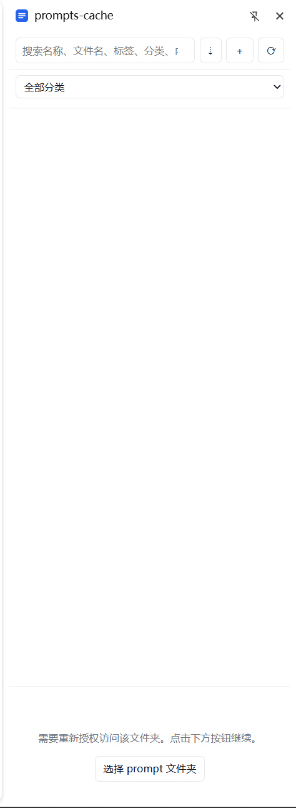

# prompts-cache

> 本地优先的 Chrome prompt 管理器：把 prompt 存成你自己的 Markdown 文件，在浏览器侧边栏里搜索、分类、一键复制。

prompts-cache 是一个 Chrome MV3 扩展。它不依赖云端、不注册账号、不上传任何内容，直接读写你指定的本地文件夹。每条 prompt 是一个 `.md` 文件，标签和分类记录在同目录的 `.prompts-cache.json` 中。

## 功能

- **本地文件存储**：prompt 以 `.md` + frontmatter 保存，文件夹就是你的数据库。
- **侧边栏常驻**：Chrome Side Panel 打开即用，不占用标签页。
- **默认展示全部**：打开侧边栏显示所有 prompt，无需先搜索。
- **递归扫描子目录**：支持 `开发/code-review.md` 这类嵌套结构，路径即唯一标识。
- **搜索**：按名称、相对路径、标签、分类、正文关键字实时过滤。
- **标签与分类**：标签多选筛选（AND），分类下拉筛选。
- **复制即用**：点击卡片或“复制”按钮，复制的是去掉 frontmatter 后的正文。
- **变量占位**：正文含 `{{变量}}` 时，复制前可弹窗填值，也可选择原样复制。
- **新建 / 编辑 / 删除**：直接在扩展内管理本地 `.md` 文件，路径可含子目录。
- **重命名 / 移动**：编辑时修改相对路径，自动写新文件、删旧文件、迁移索引。
- **批量补索引**：一键为文件夹内所有 `.md` 补全 `.prompts-cache.json` 缺失条目。
- **自动监听**：优先使用 `FileSystemObserver`，不支持时降级为 3 秒轮询；外部编辑后侧边栏自动刷新。
- **国际化**：内置简体中文与英文界面，跟随 Chrome UI 语言。
- **零网络请求**：无后端、无遥测、无第三方脚本。

## 截图

> 待确认：将截图放到 `docs/screenshot.png` 后，下面的图片才会显示。



## 安装（开发者模式）

目前未上架 Chrome Web Store，使用“加载已解压的扩展程序”安装。

1. 克隆或下载本仓库：
   ```bash
   git clone https://github.com/<your-name>/prompts-cache.git
   ```
2. 打开 `chrome://extensions`。
3. 打开右上角“开发者模式”。
4. 点击“加载已解压的扩展程序”，选择**直接包含 `manifest.json` 的那一层目录**（即仓库根目录）。
5. 点击工具栏中的 prompts-cache 图标，侧边栏打开。

要求 Chrome 114 及以上（Side Panel 最低版本）。自动监听优先使用 `FileSystemObserver`，该 API 的具体可用版本**待确认**；不支持时会自动降级为轮询，功能不受影响。

## 使用

1. 首次打开侧边栏，点击“选择 prompt 文件夹”，选择一个本地目录并授权读写。
2. 在该目录中放入 `.md` 文件，或直接点 `＋` 新建。
3. 点卡片空白处或“复制”按钮复制正文；正文含 `{{变量}}` 时会弹窗填值。
4. 顶部搜索框支持名称、相对路径、标签、分类、正文关键字。
5. 标签 chips 支持多选；分类下拉单选。
6. 点 `⇣` 为所有 `.md` 补全索引条目（已有条目不覆盖，只补缺）。
7. 点 `⟳` 手动重新扫描；正常情况下侧边栏会自动监听文件变化并刷新。
8. 点“编辑”可修改名称、相对路径、标签、分类、正文；点“删除”会删除本地文件。

### 子目录与路径

- 扫描是递归的，`开发/code-review.md`、`写作/translate.md` 都会被收录。
- 卡片的唯一标识是**相对路径**，索引 key 也使用相对路径。
- 新建时在“文件名 / 相对路径”里写 `写作/translate.md`，会自动创建 `写作/` 子目录。
- 编辑时修改路径等同于移动或重命名：写新文件 → 删旧文件 → 迁移索引。
- 路径不允许以 `/` 开头，不允许包含 `.`、`..` 片段，不允许包含 `<>:"|?*` 等非法字符。

### 变量占位

正文支持 `{{变量名}}` 形式，例如：

```md
请用 {{language}} 审查以下代码：
{{code}}
```

- 点击复制时若检测到变量，会弹出输入框，每个变量一个字段。
- **填充并复制**：用输入值替换；留空的变量保留 `{{变量}}` 原文。
- **原样复制**：直接复制未替换的正文。
- 无变量时行为不变，直接复制。
- 搜索和筛选仍按原始正文匹配，不受变量替换影响。

## 文件格式

### Prompt 文件

每个 prompt 是一个 `.md` 文件，frontmatter 只保留 `name`，正文就是复制内容：

```md
---
name: 代码审查
---

请从可读性、边界条件、安全性三个角度审查以下代码：
```

没有 `name` 时，使用文件名去掉 `.md` 作为名称。文件可以放在子目录中，路径如 `开发/code-review.md`。

### 索引文件

标签和分类存放在所选文件夹根目录的 `.prompts-cache.json`，key 为相对路径：

```json
{
  "version": 1,
  "items": {
    "code-review.md": {
      "tags": ["开发", "审查"],
      "category": "工程"
    },
    "写作/translate.md": {
      "tags": ["写作"],
      "category": "日常"
    }
  }
}
```

该文件由扩展维护，也可以手动编辑。删除 prompt 时，对应条目会一并移除。

## 数据与隐私

- 扩展只访问你通过 `showDirectoryPicker()` 主动授权的文件夹。
- 不发送任何网络请求，不收集、不上传 prompt 内容或使用数据。
- 文件夹句柄保存在浏览器 IndexedDB 中，仅用于下次打开时恢复访问。
- 自动监听只读取文件元数据（mtime），不额外上传任何内容。
- 权限说明：
  - `sidePanel`：在侧边栏中显示界面。
  - `clipboardWrite`：复制 prompt 正文到剪贴板。
  - `unlimitedStorage`：保存文件夹句柄等本地状态。

## 目录结构

```text
prompts-cache/
├── manifest.json
├── background.js
├── sidepanel.html
├── sidepanel.css
├── sidepanel.js
├── generate-icons.ps1
├── icons/
│   ├── icon.svg
│   ├── icon16.png
│   ├── icon32.png
│   ├── icon48.png
│   └── icon128.png
├── _locales/
│   ├── en/messages.json
│   └── zh_CN/messages.json
└── lib/
    ├── fs.js
    └── frontmatter.js
```

## 开发

本项目无构建步骤，纯静态文件，修改后刷新扩展即可。

生成图标（需要 PowerShell + System.Drawing，Windows 自带）：

```powershell
powershell -ExecutionPolicy Bypass -File .\generate-icons.ps1
```

脚本会输出 `icons/icon16.png`、`icon32.png`、`icon48.png`、`icon128.png`。若脚本报“字符串缺少终止符”，通常是 PowerShell 5.1 按 ANSI 读取 UTF-8 导致，将脚本保存为 UTF-8 with BOM，或使用纯英文提示。

调试：

- 扩展页面：`chrome://extensions` → 该扩展 → “检查视图”打开 DevTools。
- 侧边栏：右键侧边栏 → “检查”。

## 已知限制

- 外部修改文件后依赖自动监听或手动点 `⟳` 刷新；若 `FileSystemObserver` 不可用，轮询间隔为 3 秒。
- 重命名和移动通过“写新文件 → 删旧文件 → 迁移索引”实现，极端失败情况下可能残留旧文件。
- 多窗口同时写 `.prompts-cache.json` 可能互相覆盖，建议单窗口使用。
- 仅支持 Chrome 114+；Firefox 需要额外适配。
- 批量补索引只补缺，不清理“索引里存在但文件已删除”的条目；这类条目可通过手动编辑 `.prompts-cache.json` 清理。

## 路线图

- [x] 递归扫描子目录
- [x] 导入已有 `.md` 批量生成索引
- [x] 自动监听文件变化
- [x] 复制前可选变量占位

## 贡献

欢迎提 Issue 和 PR。提交前请确认：

- 不引入远程脚本或 CDN 依赖。
- 不新增与核心功能无关的权限。
- 保持本地优先、零网络请求。

## 免责声明

本项目按“现状”提供，不提供任何明示或暗示担保。删除和移动操作会直接修改本地文件，请自行备份重要 prompt。